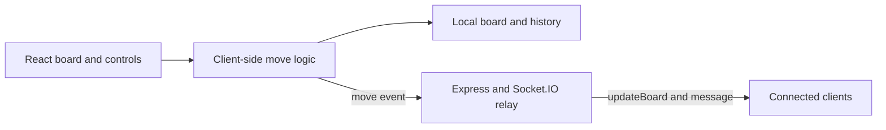

# Turn-Based Strategy Game

**A 5×5 chess-like game prototype built with React and Socket.IO.**

This project explores board-state updates, piece-specific movement, and browser-to-server events. It is useful for learning where game rules, local UI state, and shared network state meet.

## Gameplay

Each side starts with three pawns, Hero1, and Hero2. Select a piece belonging to the current player, then choose one of its available moves.

| Piece | Implemented movement |
|---|---|
| Pawn | One square left, right, forward, or backward |
| Hero1 | Two squares horizontally or vertically |
| Hero2 | Two squares diagonally |

The client checks board bounds and destination occupancy, records moves, handles captures, and detects when the opposing side has no pieces remaining.

## Architecture



The server relays submitted board updates. It does not validate moves or own an authoritative game state. Turn, history, and winner state remain local to each client, so independent browser sessions can diverge.

## Run locally

Download and extract the repository. Before running both parts:

1. Point the `io(...)` URL in `client/src/App.js` to your local server, normally `http://localhost:4000`.
2. Add your React development origin, normally `http://localhost:3000`, to `allowedOrigins` in `server/index.js`.

Start the server:

```bash
cd server
npm install
npm start
```

In a second terminal, from the repository root:

```bash
cd client
npm install
npm start
```

The server uses `PORT` if supplied and otherwise listens on port 4000. Client and server URLs are currently configured directly in source.

## Try an interaction

Open the client, select an A-side pawn, and choose **F**. The local board advances the pawn and records the move. A connected client receives the updated board and message, but additional state synchronization is needed for a complete multiplayer game.

## Repository guide

- `client/src/App.js`: board setup, movement rules, move history, and Socket.IO client.
- `client/src/App.css`: board presentation.
- `server/index.js`: HTTP server, CORS configuration, and event relay.

## Current scope and contributions

The code is JavaScript. Persistent sessions, server-side rule enforcement, reconnect restoration, separate game rooms, and a dedicated spectator role are not implemented. Contributions should start with authoritative state and complete turn synchronization, then document how two browser clients behave.
